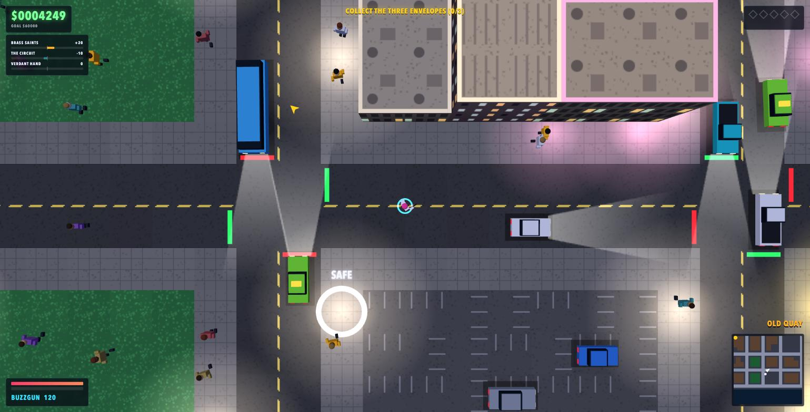
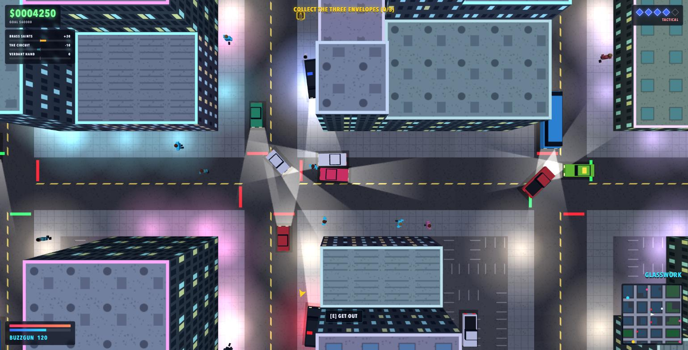

# Neon Ledger





An original top-down, open-city crime-action game that runs in the browser. You arrive in
the island city of Halcyon Reach with nothing, work for three rival crews, dodge the
police, and try to bank **$60,000**.

Built with Three.js, TypeScript and Vite. Everything is generated at runtime: the city is
procedural (from a fixed seed), textures are drawn on canvas, and all sound is synthesised
with Web Audio. There are no external art or audio assets.

## Running it

Requires [Node.js](https://nodejs.org/) 20 or newer.

```bash
npm install     # first time only
npm run dev
```

Open the URL it prints (by default http://localhost:5173/) and click **New game**.

Other commands:

| Command           | What it does                                        |
| ----------------- | --------------------------------------------------- |
| `npm run build`   | Type-check and produce a production build in `dist` |
| `npm run preview` | Serve the production build locally                  |
| `npm test`        | Run the simulation tests                            |

## Controls

| Input                | Action                                             |
| -------------------- | -------------------------------------------------- |
| `W A S D` / arrows   | Move on foot, accelerate / brake / steer in a car  |
| Mouse                | Aim; left button fires (`Ctrl` also fires)         |
| `Space`              | Handbrake in a car, fire on foot                   |
| `E`                  | Enter or leave a vehicle                           |
| `F`                  | Take a job at a JOBS terminal                      |
| `Q`, wheel, `1`–`7`  | Switch weapon                                      |
| `P` / `Esc`          | Pause                                              |
| `M`                  | Mute                                               |

A gamepad also works: left stick to move or steer, triggers to accelerate and brake.

## How to play

- **Jobs.** Each district has a glowing **JOBS** ring belonging to the crew that runs it.
  Stand in it on foot and press `F`. A yellow arrow and a minimap blip point to your
  objective.
- **Crews.** The Brass Saints (Old Quay), The Circuit (Glasswork) and the Verdant Hand
  (Greenhouse Row). Finishing a job raises your respect with that crew and lowers it with
  their rival. Later jobs need more respect, and a crew that dislikes you enough will
  shoot on sight.
- **Heat.** Crimes raise your heat through five levels, from patrol cars to roadblocks to
  armoured units. Lose it by staying out of sight, or drive into a **PAINT** ring for a
  $400 respray. If an officer reaches you while you are stopped or on foot, you are
  booked.
- **Vehicles.** Any vehicle can be taken. A car that catches fire will explode a couple
  of seconds later, so get out.
- **Pickups.** Weapons, health, armour and cash are scattered around the city and
  respawn. Weapons are picked up on foot.
- **Saving.** Walk into a **SAFE** ring on foot (not during a job) to heal and save.
  Progress is stored in the browser's local storage.
- **Going down.** Being killed or booked fails the current job, costs you your weapons
  and 10% of your cash, and puts you back at the nearest safehouse.

## Project layout

```
src/
  main.ts          bootstrap, fixed 60 Hz simulation loop, event wiring
  engine/          input, synthesised audio, seeded RNG
  world/           city generation and city mesh
  data/            vehicle, weapon, faction and mission definitions
  sim/             game logic with no rendering dependencies
                   (vehicles, traffic, pedestrians, weapons, police heat,
                   missions, saving)
  render/          Three.js renderer, particles, HUD and minimap
tests/             Vitest tests for the simulation
```

The simulation in `src/sim` never touches the DOM or Three.js, which is what lets the
tests run it headlessly. For debugging, the running game is exposed in the browser
console as `window.__game`.
